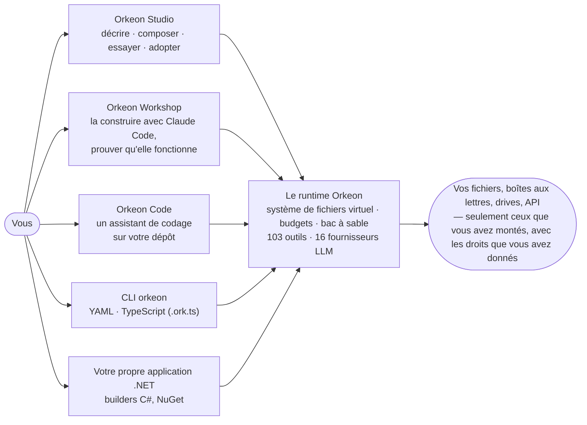

> 🇬🇧 [English version](README.md)

# Orkeon

[](https://github.com/Orkeon/orkeon/actions/workflows/ci.yml)
[](https://github.com/Orkeon/orkeon/releases)
[](https://www.nuget.org/packages/Orkeon)
[](https://orkeon.github.io/orkeon/)
[](LICENSE.md)

<p align="center">
  
</p>

**Confiez un vrai travail à une équipe d'agents IA — vos fichiers, votre boîte aux lettres, vos drives, votre code — en sachant exactement ce qu'elle a le droit de toucher.** Orkeon, c'est un runtime .NET qui exécute des équipes d'agents sous des règles déclarées à l'avance et appliquées à chaque appel, et une suite d'outils — Orkeon Studio, Orkeon Workshop, Orkeon Code, le CLI `orkeon` — pour concevoir, essayer, exécuter et gérer ces équipes. Il tourne aussi bien sur un modèle installé sur votre machine que chez un fournisseur cloud ; aucune clé d'API pour commencer.

Version **1.0.0-rc.5**, MIT, .NET 10. Trois dépôts : celui-ci (le runtime, le CLI, Studio), [orkeon-workshop](https://github.com/Orkeon/orkeon-workshop) et [orkeon-code](https://github.com/Orkeon/orkeon-code).

## Ce qu'une équipe fait pour vous

- **Chaque matin, votre boîte aux lettres est triée.** Une équipe lit le courrier, classe les factures, prépare les trois réponses qui comptent — et n'envoie rien tant que vous ne l'avez pas dit.
- **Un dossier de PDF devient un rapport.** Chercheur, analyste, rédacteur : trois agents, un dossier `/documents` qu'ils peuvent lire, un dossier `/output` qu'ils peuvent écrire.
- **Votre pull request a droit à un second regard.** Orkeon Code la relit, sous le mode de permission que vous avez choisi, dans le seul projet que vous avez monté.
- **Une question tombe sur vos documents, pas sur le web.** Du RAG sur vos fichiers, un modèle local, rien ne quitte le portable.

Chacune de ces équipes se décrit en une phrase — `orkeon forge "une équipe qui trie ma boîte aux lettres chaque matin"` — et chacune travaille dans les limites que vous avez tracées.

## Comment ça marche



**La frontière est devant le modèle, pas derrière.** Un agent voit des dossiers virtuels (`/workspace`, `/output`), chacun un montage que vous avez déclaré avec les droits que vous avez donnés ; un chemin en dehors est refusé avant qu'un seul octet n'atteigne le disque. L'envoi de mails et le partage d'un drive restent fermés tant qu'un opérateur ne les ouvre pas. Le code s'exécute dans un bac à sable.

**L'autonomie a un budget.** Appels d'outils, profondeur, temps, tokens, agents engendrés : l'exécution s'arrête quand le budget est épuisé, et des disjoncteurs attrapent les boucles. Une longue exécution pose des points de reprise et repart là où elle s'était arrêtée.

**Ça se livre comme du logiciel.** Le même runtime tourne en service `orkeon-host`, en conteneur (`ghcr.io/orkeon/orkeon-runners`), en paquet apt ou en binaire autonome, ou embarqué dans votre propre service .NET — OpenTelemetry sur le tableau de bord .NET Aspire, interopérabilité Microsoft Agent Framework, client et serveur MCP, A2A entre agents. Et pour votre propre C#, [`Orkeon.Compliance.Vfs`](docs/architecture/vfs-compliance.md) : un analyseur Roslyn après lequel un `System.IO` brut ne compile plus.

## Essayez-le en deux minutes — sans clé d'API

Un modèle local, un agent, un dossier en écriture. Avec [Ollama](https://ollama.com) et le SDK .NET 10 installés :

<!-- quickstart:begin -->
```bash
ollama pull qwen2.5:1.5b
dotnet tool install -g Orkeon.Scripting.Cli --prerelease
orkeon quickstart && cd orkeon-quickstart
orkeon run crew.yaml --mount ./out:/output:rw
```
<!-- quickstart:end -->

`out/hello.md` apparaît — écrit par un agent qui n'a jamais vu `out/` : il a vu `/output`, le seul endroit où cette exécution l'autorisait à écrire. Maintenant la même équipe, la même commande, le montage en lecture seule :

<!-- quickstart-refused:begin -->
```bash
orkeon run crew.yaml --mount ./out:/output:ro
```
<!-- quickstart-refused:end -->

```
file_write [FAIL]: Error: Access denied for '/output/hello.md': required Write, effective ReadOnly. Mounts granting Write: (none).
```

Refusé avant qu'un octet n'atteigne le disque. La CI exécute les deux blocs à chaque changement, contre une Ollama épinglée : le README est le test.

## Choisissez votre porte

| | |
|---|---|
| **Orkeon Studio** | L'application de bureau. **Décrire → Composer → Essayer → Adopter** : dites ce que l'équipe doit faire, laissez l'assistant proposer les agents, leurs tâches et les dossiers qu'ils peuvent toucher — ou partez d'un des 104 cas d'usage —, essayez-la sur un échantillon, adoptez-la à la demande, toutes les heures ou chaque jour. Puis lancez-la, suivez ce qu'elle coûte, relisez l'historique, gérez modèles, dossiers, boîtes aux lettres et drives depuis un seul écran de réglages. Mode novice ou expert, cinq langues, pas de code. L'application de bureau est Windows ; Linux a deux applications terminal, un éditeur de réglages et un lanceur d'exécution — [Orkeon Studio](docs/fr/architecture/studio.md). |
| **Orkeon Workshop** | Claude Code, harnaché. Une image de conteneur — Claude Code, le CLI Orkeon, des modèles locaux sur votre GPU — et une méthode : besoin → tests → équipe → exécutions → acceptée, chaque tentative et chaque décision gardées sur disque, une exécution payante qui attend votre accord. Les équipes en sortent prêtes pour Studio ; le même harnais travaille sur Orkeon lui-même — [Orkeon/orkeon-workshop](https://github.com/Orkeon/orkeon-workshop). |
| **Orkeon Code** | Un assistant de codage sur le runtime Orkeon. Travaillez en binôme dans le terminal sous le mode de permission de votre choix, ou laissez-le mener une tâche jusqu'au bout ; `/review`, `/commit`, `/security-review`, `/analyze` ; un seul projet monté, un shell en liste blanche. Alpha — [Orkeon/orkeon-code](https://github.com/Orkeon/orkeon-code). |
| **Le CLI `orkeon`** | `orkeon run` exécute une équipe écrite en YAML ou en TypeScript (`.ork.ts`) ; `orkeon forge "…"` en rédige une à partir d'une phrase, la teste en bac à sable et la promeut ; `orkeon quickstart` écrit l'équipe « deux minutes » ci-dessus ; `init`, `doctor`, `email login` et `drive login` font la plomberie — [référence du CLI](docs/fr/reference/cli.md). |
| **La bibliothèque** | `dotnet add package Orkeon --prerelease` — le même moteur dans votre produit : builders C#, Clean Architecture, typé de bout en bout — [Amorçage et exécution](docs/fr/getting-started/bootstrap.md). |

L'équipe que vous composez dans Studio est le YAML que le CLI exécute, et l'équipe que votre propre code .NET charge. Un seul runtime, les mêmes règles, quelle que soit la porte.

## Ce qu'il y a dans la boîte

103 outils intégrés (mail en IMAP, SMTP et Microsoft Graph ; Google Drive et OneDrive ; web, HTTP, bases de données, Office et PDF, exécution de code sécurisée, analyse sémantique de code) · 16 fournisseurs LLM, modèles locaux compris (Ollama, Docker Model Runner, llama.cpp embarqué) · 6 fournisseurs de mémoire · 6 stratégies d'orchestration, de la simple séquence au graphe ou à l'équipe autonome sous budget · points de reprise · plugins dans des contextes de chargement isolés · 104 exemples exécutables. Chaque nombre de cette page est recalculé par la CI à chaque changement — un README qui s'en écarte fait échouer le build.

## Installer

| | |
|---|---|
| **Windows** — CLI + Studio | `orkeon-cli-<version>-win-x64.zip` ou le `.msi` depuis les [releases](https://github.com/Orkeon/orkeon/releases), puis `install.cmd`. Autonome. |
| **Debian / Ubuntu** — CLI + applications terminal de Studio | `sudo apt install orkeon` après avoir ajouté la [source apt signée](docs/fr/guides/install-with-apt.md). |
| **macOS** — CLI | L'archive `osx-arm64` / `osx-x64` depuis les releases, puis `./install.sh`. |
| **Conteneur** | `docker run -it --rm -e ORKEON_RUNNER=shell ghcr.io/orkeon/orkeon-runners` — les exemples embarqués. |
| **Dans votre application .NET** | `dotnet add package Orkeon --prerelease` (+ `Orkeon.Tools` pour les outils intégrés). |
| **Depuis les sources** | `git clone` **sans** `--recursive` (les sous-modules privés du mainteneur ne servent à rien de public), puis `dotnet build Orkeon.sln` — [Depuis les sources](docs/fr/getting-started/three-ways-to-run-orkeon.md#1-depuis-les-sources). |

Puis `orkeon init` pour choisir un fournisseur et un modèle ; `orkeon doctor` quand quelque chose cloche. Sommes de contrôle, attestations signées, mises à jour : [Trois façons d'exécuter Orkeon](docs/fr/getting-started/three-ways-to-run-orkeon.md) · [Vérifier ce que vous installez](docs/fr/guides/verify-what-you-install.md).

## Aller plus loin

[Premiers pas](docs/fr/getting-started/overview.md) · [Écrire une équipe en YAML, TypeScript ou C#](docs/fr/getting-started/yaml-and-builders.md) · [Forger une équipe à partir d'un besoin](docs/fr/getting-started/forge-a-team-from-a-need.md) · [Donner une boîte aux lettres à vos agents](docs/fr/getting-started/give-your-agents-a-mailbox.md) · [Modèles locaux](docs/fr/guides/local-models.md) · [Orchestration](docs/fr/orchestration/process-types.md) · [Orkeon Studio](docs/fr/architecture/studio.md) · [Exemples](https://github.com/Orkeon/orkeon/tree/main/examples) · [Index complet](docs/fr/INDEX.md) *(aussi [en anglais](docs/INDEX.md))* — publié sur **<https://orkeon.github.io/orkeon/>**.

## Rejoignez-nous

Montrez-nous ce que fait votre équipe : les [Discussions](https://github.com/Orkeon/orkeon/discussions) accueillent les questions et les démonstrations. Les bugs et les idées passent par les [formulaires d'issue](https://github.com/Orkeon/orkeon/issues/new/choose), les vulnérabilités par le [signalement privé](SECURITY.fr.md). Les contributions sont bienvenues — [CONTRIBUTING.fr.md](CONTRIBUTING.fr.md) dit comment, le [code de conduite](CODE_OF_CONDUCT.fr.md) dans quel esprit.

La couverture est [mesurée en public](https://github.com/Orkeon/orkeon/actions/workflows/coverage.yml), les limites connues sont dans [limitations](docs/fr/reference/limitations.md), et ce qui se passe si le projet s'arrête est écrit dans [SUPPORT.fr.md](SUPPORT.fr.md#si-le-projet-sarrête) : MIT, un build reproductible, aucune infrastructure privée, forkable par quiconque.

## Licence

Orkeon est publié sous [licence MIT](LICENSE.md).
