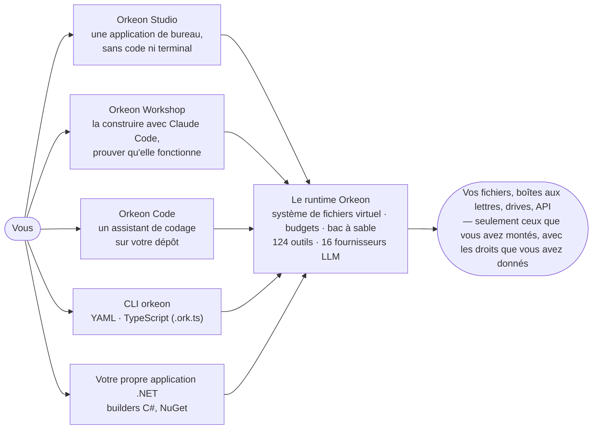

> 🇬🇧 [English version](README.md)

# Orkeon

[](https://github.com/Orkeon/orkeon/actions/workflows/ci.yml)
[](https://github.com/Orkeon/orkeon/releases)
[](https://www.nuget.org/packages/Orkeon)
[](https://orkeon.github.io/orkeon/)
[](LICENSE.md)

<p align="center">
  
</p>

**Des équipes d'agents IA qui restent dans le cadre.** Chaque fichier, chaque point d'accès et chaque budget qu'un agent peut utiliser est déclaré, puis appliqué par le runtime.

Orkeon est un framework open source pour construire et orchestrer des équipes d'agents IA en .NET : un runtime unique qui exécute une équipe sous des règles déclarées à l'avance et appliquées à chaque appel, et une suite d'outils — Orkeon Studio, Orkeon Workshop, Orkeon Code, le CLI `orkeon` — pour concevoir, essayer, exécuter et gérer ces équipes. Il tourne aussi bien sur un modèle installé sur votre machine que chez un fournisseur cloud ; aucune clé d'API pour commencer.

MIT, .NET 10. Quatre dépôts : celui-ci (le runtime, le CLI), [orkeon-workshop](https://github.com/Orkeon/orkeon-workshop), [orkeon-code](https://github.com/Orkeon/orkeon-code) et [orkeon-studio](https://github.com/Orkeon/orkeon-studio).

## Pourquoi Orkeon

Les agents IA savent désormais agir : lire des fichiers, appeler des API, écrire du code, envoyer des messages. C'est ce qui les rend utiles, et c'est ce qui les rend risqués. Deux obstacles les empêchent de quitter le stade de la démonstration. **L'absence de cadre** : un agent autonome peut lire ce qu'il ne devait pas lire, écrire là où il ne fallait pas, tourner en boucle ou consommer sans limite. **L'absence de continuité** : l'outil qui sert à mettre au point un agent est rarement celui qui sert à construire l'application, et le prototype est réécrit avant de devenir un produit. Le problème n'est pas l'intelligence des modèles ; c'est ce qui manque autour d'eux.

Orkeon repose sur deux convictions :

1. **La confiance se construit dans le runtime, pas dans le prompt.** Une consigne dans un prompt est une demande : le modèle peut l'ignorer. Une règle dans le runtime est une limite : elle s'applique quoi que le modèle décide.
2. **Ce que l'on met au point doit être ce que l'on déploie.** Une équipe d'agents ne devrait jamais être réécrite pour passer de l'essai à l'application.

Deux mots reviennent partout : une **équipe** (*crew* dans le code) est un ensemble d'agents, chacun avec un rôle, qui coopèrent pour accomplir une mission ; le **runtime** est le moteur qui exécute l'équipe et qui applique les règles. Il n'y en a qu'un, quel que soit le mode d'utilisation.

## Ce qu'une équipe fait pour vous

- **Chaque matin, votre boîte aux lettres est triée.** Une équipe lit le courrier, classe les factures, prépare les trois réponses qui comptent — et n'envoie rien tant que vous ne l'avez pas dit.
- **Un dossier de PDF devient un rapport.** Chercheur, analyste, rédacteur : trois agents, un dossier `/documents` qu'ils peuvent lire, un dossier `/output` qu'ils peuvent écrire.
- **Votre pull request a droit à un second regard.** Orkeon Code la relit, sous le mode de permission que vous avez choisi, dans le seul projet que vous avez monté.
- **Une question tombe sur vos documents, pas sur le web.** Du RAG sur vos fichiers, un modèle local, rien ne quitte le portable.

Chacune de ces équipes se décrit en une phrase — `orkeon forge "une équipe qui trie ma boîte aux lettres chaque matin"` — et chacune travaille dans les limites que vous avez tracées.

## Comment ça marche



### Un cadre déclaré, puis appliqué

**Ce qu'un agent peut toucher est déclaré.** Un agent ne voit jamais le disque réel : il voit des dossiers virtuels (`/workspace`, `/output`), chacun un montage que vous avez déclaré avec les droits que vous avez donnés, lecture seule ou lecture-écriture ; un chemin en dehors est refusé avant qu'un seul octet n'atteigne le disque. Les outils de fichiers d'Orkeon passent par ce système de fichiers virtuel ; un outil qui lance un processus, comme le shell, s'exécute sous son propre confinement ([limites connues](docs/fr/reference/limitations.md)). La même logique s'applique aux autres ressources : points d'accès, messagerie, code exécuté dans un bac à sable.

**Ce qui est sensible reste fermé tant qu'un humain ne l'a pas ouvert.** L'envoi de mails et le partage d'un drive restent fermés tant qu'un opérateur n'a pas ouvert la liste des destinataires autorisés. Quand un hôte active le contrôle de permission, une action qui demande un accord part vers le canal d'approbation de l'hôte, donc vers une personne, et elle est refusée si l'hôte n'en a pas : le modèle ne peut pas se l'accorder ; et une équipe générée à partir d'une phrase n'est, par défaut, adoptée qu'après votre verdict. Ouvrir un accès est une décision humaine, jamais une déduction de l'agent.

**L'autonomie a un budget.** Une équipe autonome tourne sous un budget d'appels d'outils, de profondeur, de temps réel, de tokens et d'agents engendrés : l'exécution s'arrête quand le budget est épuisé, et des disjoncteurs interceptent les boucles. Les autres modes sont bornés par le plafond de tokens et de coût que fixe l'hôte ; il n'y en a pas par défaut. Un agent peut échouer ; il ne peut pas dépenser au-delà de ce qu'on lui a alloué.

**La règle peut s'imposer au code lui-même.** [`Orkeon.Compliance.Vfs`](docs/fr/architecture/vfs-compliance.md) est un analyseur Roslyn autonome : ajoutez-le à n'importe quel projet C#, avec ou sans Orkeon, et un accès direct aux fichiers par `System.IO` ne compile plus.

### De l'idée à l'application, sans rupture

**Une équipe, trois écritures, un seul runtime.**

| Écriture | Usage |
|---|---|
| **YAML** | Une description déclarative, lisible et versionnable, sans code |
| **TypeScript** (`.ork.ts`) | La souplesse du script, transpilé à la volée, sans recompilation |
| **C#** | Le contrôle total, au cœur d'une application .NET |

Le même runtime exécute les trois. Aucune écriture n'est une étape provisoire : on choisit selon la complexité que l'équipe doit traiter, pas selon le stade du projet. Une équipe écrite en YAML ou en TypeScript a toute sa place dans une application C#, et peut y rester.

**L'équipe mise au point est celle que l'on intègre.** Le runtime qui exécute le premier essai est celui qui tourne dans l'application finale : pas de redéveloppement, pas d'impasse — si la complexité grandit, on change d'écriture sans changer de socle — et le cadre suit l'équipe, puisque montages, budgets et disjoncteurs sont portés par le runtime. Ce qui change d'un environnement à l'autre, c'est la configuration : le modèle, les dossiers montés, les secrets. La définition de l'équipe, elle, ne change pas. Orkeon Code en est la démonstration : l'assistant de codage du projet est lui-même construit sur le runtime Orkeon, s'utilise dans un terminal, tourne en autonomie depuis un script ou une chaîne d'intégration, et une autre application lance ses équipes par le CLI `orkeon`.

**Un agent est un logiciel, pas un script.** Une équipe se déploie, garde son état et s'observe comme n'importe quel service. *Déploiement* : le CLI `orkeon`, un conteneur (`ghcr.io/orkeon/orkeon`), des paquets natifs pour Windows (MSI) et Debian ou Ubuntu (apt), une archive autonome pour macOS, le service `orkeon-host`, ou une bibliothèque embarquée dans votre propre application .NET. *État* : mémoire dans un magasin durable et points de reprise, tous deux à activer, pour reprendre une exécution interrompue là où elle s'était arrêtée ; les réponses du modèle d'une exécution s'enregistrent et se rejouent, et deux rapports d'évaluation se comparent. *Observabilité* : traces, métriques et journaux exportés par OpenTelemetry — le tableau de bord .NET Aspire les lit — et un flux d'événements par exécution.

### Un projet ouvert

**Des standards, pas d'enfermement.** MCP comme client et comme serveur (le serveur en stdio) ; A2A, encore expérimental, pour la découverte et la communication entre agents ; Microsoft Agent Framework dans les deux sens — une équipe Orkeon s'exécute comme un agent MAF, et un agent MAF peut servir de cerveau ou d'outil à un agent Orkeon. Orkeon ne cherche pas à remplacer ces briques : il s'y branche. Le choix du modèle reste libre : fournisseurs cloud, agrégateurs ou modèles locaux.

**Ouvert et vérifiable.** MIT. Un cadre de sécurité ne se croit pas sur parole : celui-ci peut être lu, testé et contesté, et ses [limites connues](docs/fr/reference/limitations.md) sont documentées avec le projet.

## Essayez-le en deux minutes — sans clé d'API

Un modèle local, un agent, un dossier en écriture. Avec [Ollama](https://ollama.com) et le SDK .NET 10 installés :

<!-- quickstart:begin -->
```bash
ollama pull qwen2.5:1.5b
dotnet tool install -g Orkeon.Scripting.Cli
orkeon quickstart && cd orkeon-quickstart
orkeon run crew.yaml --mount ./out:/output:rw
```
<!-- quickstart:end -->

`out/hello.md` apparaît — écrit par un agent qui n'a jamais vu `out/` : il a vu `/output`, le seul endroit où cette exécution l'autorisait à écrire. Maintenant la même équipe, la même commande, le montage en lecture seule :

<!-- quickstart-refused:begin -->
```bash
orkeon run crew.yaml --mount ./out:/output:ro
```
<!-- quickstart-refused:end -->

```
file_write [FAIL]: Error: Access denied for '/output/hello.md': required Write, effective ReadOnly. Mounts granting Write: (none).
```

Refusé avant qu'un octet n'atteigne le disque. La CI exécute les deux blocs à chaque changement, contre une Ollama épinglée : le README est le test.

## Choisissez votre porte

| | |
|---|---|
| **Orkeon Studio** | Une application de bureau pour Windows 10 et 11 uniquement : créez une équipe sans code ni terminal, en quatre étapes — *Describe → Compose → Try → Adopt*. Elle pilote le CLI `orkeon`, à installer au préalable — [Orkeon/orkeon-studio](https://github.com/Orkeon/orkeon-studio). |
| **Orkeon Workshop** | Claude Code, harnaché. Une image de conteneur — le CLI Orkeon, des modèles locaux sur votre GPU, Claude Code installé au premier démarrage — et une méthode : besoin → tests → équipe → exécutions → acceptée, chaque tentative et chaque décision gardées sur disque, une exécution payante qui attend votre accord. Les équipes en sortent prêtes pour le CLI `orkeon` ; le même harnais travaille sur Orkeon lui-même — [Orkeon/orkeon-workshop](https://github.com/Orkeon/orkeon-workshop). |
| **Orkeon Code** | Un assistant de codage sur le runtime Orkeon. Travaillez en binôme dans le terminal sous le mode de permission de votre choix, ou laissez-le mener une tâche jusqu'au bout ; `/review`, `/commit`, `/security-review`, `/analyze` ; un seul projet monté, un shell en liste blanche — [Orkeon/orkeon-code](https://github.com/Orkeon/orkeon-code). |
| **Le CLI `orkeon`** | `orkeon run` exécute une équipe écrite en YAML ou en TypeScript (`.ork.ts`) ; `orkeon forge "…"` en rédige une à partir d'une phrase, la teste en bac à sable et la promeut ; `orkeon quickstart` écrit l'équipe « deux minutes » ci-dessus ; `init`, `doctor`, `email login` et `drive login` font la plomberie — [référence du CLI](docs/fr/reference/cli.md). |
| **La bibliothèque** | `dotnet add package Orkeon` — le même moteur dans votre produit : builders C#, Clean Architecture, typé de bout en bout — [Amorçage et exécution](docs/fr/getting-started/bootstrap.md). |

L'équipe que vous forgez à partir d'une phrase est le YAML que le CLI exécute, et l'équipe que votre propre code .NET charge. Un seul runtime, les mêmes règles, quelle que soit la porte.

## Ce qu'Orkeon garantit, et ce qu'il ne garantit pas

**Orkeon garantit un périmètre.** Un agent n'accède qu'à ce qui a été déclaré, avec les droits déclarés, dans le budget alloué.

**Orkeon ne garantit pas ce qui se passe à l'intérieur de ce périmètre.** Trois limites, dites clairement :

- **Un agent peut se tromper.** Le cadre borne les conséquences d'une erreur ; il ne rend pas le résultat juste. La relecture humaine reste nécessaire là où l'enjeu le demande.
- **Un droit accordé peut être mal utilisé.** Dans un dossier ouvert en écriture, un agent peut écrire ce qu'il ne fallait pas. La précision des déclarations fait la qualité du cadre.
- **Ce qu'un agent lit est transmis au modèle.** Avec un fournisseur cloud, ces données quittent l'entreprise ; avec un modèle local, elles y restent. Orkeon permet les deux et laisse ce choix à ceux qui en portent la responsabilité.

## Ce qu'Orkeon n'est pas

- **Pas un outil de démonstration.** Il est conçu pour la production, pas pour le prototype jetable.
- **Pas une chaîne de prompts.** Il fournit l'état, la mémoire, les outils, le déploiement et l'observabilité.
- **Pas une impasse.** Ce qui est mis au point avec Orkeon s'intègre dans une application sans être réécrit.
- **Pas un garde-fou ajouté après coup.** Les limites sont dans le runtime dès le départ, pas dans un filtre posé à la sortie.

## À qui s'adresse Orkeon

- Aux **équipes .NET** qui veulent industrialiser des agents sans quitter leur écosystème.
- Aux **architectes et responsables sécurité** qui doivent pouvoir dire précisément ce qu'un agent a le droit de faire.
- Aux **métiers** qui veulent automatiser une tâche sans écrire de code, en sachant exactement à quoi leurs agents ont accès.

## Ce qu'il y a dans la boîte

124 outils intégrés (mail en IMAP, SMTP et Microsoft Graph ; Google Drive et OneDrive ; web, HTTP, bases de données, Office et PDF, exécution de code sécurisée, analyse sémantique de code) · 16 fournisseurs LLM (14 éditeurs, 2 agrégateurs), modèles locaux compris (Ollama, Docker Model Runner, llama.cpp embarqué) · 6 fournisseurs de mémoire · 6 stratégies d'orchestration, de la simple séquence au graphe ou à l'équipe autonome sous budget · un pipeline RAG par étapes · points de reprise · plugins dans des contextes de chargement isolés · 104 exemples exécutables. Chaque nombre de cette page est recalculé par la CI à chaque changement — un README qui s'en écarte fait échouer le build.

## Installer

| | |
|---|---|
| **Windows** — CLI | `orkeon-cli-<version>-win-x64.zip` ou le `.msi` depuis les [releases](https://github.com/Orkeon/orkeon/releases), puis `install.cmd`. Autonome. |
| **Debian / Ubuntu** — CLI | `sudo apt install orkeon` après avoir ajouté la [source apt signée](docs/fr/guides/install-with-apt.md). |
| **macOS** — CLI | L'archive `osx-arm64` / `osx-x64` depuis les releases, puis `./install.sh`. |
| **Conteneur** | `docker run -it --rm -e ORKEON_ENTRYPOINT=shell ghcr.io/orkeon/orkeon` — les exemples embarqués. |
| **Dans votre application .NET** | `dotnet add package Orkeon` (+ `Orkeon.Tools` pour les outils intégrés). |
| **Depuis les sources** | `git clone`, puis `dotnet build Orkeon.sln` — [Depuis les sources](docs/fr/getting-started/three-ways-to-run-orkeon.md#1-depuis-les-sources). Pour mettre ce que vous avez compilé sur votre `PATH` : `scripts/install-from-source.ps1` sous Windows, `scripts/install-from-source.sh` sous Linux et macOS — [Installer depuis les sources](docs/fr/getting-started/three-ways-to-run-orkeon.md#installer-depuis-les-sources), [avec le REPL](docs/fr/getting-started/three-ways-to-run-orkeon.md#installer-le-repl-depuis-les-sources). |

Puis `orkeon init` pour choisir un fournisseur et un modèle ; `orkeon doctor` quand quelque chose cloche. Sommes de contrôle, attestations signées, mises à jour : [Trois façons d'exécuter Orkeon](docs/fr/getting-started/three-ways-to-run-orkeon.md) · [Vérifier ce que vous installez](docs/fr/guides/verify-what-you-install.md).

## Aller plus loin

[Premiers pas](docs/fr/getting-started/overview.md) · [Écrire une équipe en YAML, TypeScript ou C#](docs/fr/getting-started/yaml-and-builders.md) · [Forger une équipe à partir d'un besoin](docs/fr/getting-started/forge-a-team-from-a-need.md) · [Donner une boîte aux lettres à vos agents](docs/fr/getting-started/give-your-agents-a-mailbox.md) · [Modèles locaux](docs/fr/guides/local-models.md) · [Orchestration](docs/fr/orchestration/process-types.md) · [Exemples](https://github.com/Orkeon/orkeon/tree/main/examples) · [Index complet](docs/fr/INDEX.md) *(aussi [en anglais](docs/INDEX.md))* — publié sur **<https://orkeon.github.io/orkeon/>**.

## Rejoignez-nous

Montrez-nous ce que fait votre équipe : les [Discussions](https://github.com/Orkeon/orkeon/discussions) accueillent les questions et les démonstrations. Les bugs et les idées passent par les [formulaires d'issue](https://github.com/Orkeon/orkeon/issues/new/choose), les vulnérabilités par le [signalement privé](SECURITY.fr.md). Les contributions sont bienvenues — [CONTRIBUTING.fr.md](CONTRIBUTING.fr.md) dit comment, le [code de conduite](CODE_OF_CONDUCT.fr.md) dans quel esprit.

La couverture est [mesurée en public](https://github.com/Orkeon/orkeon/actions/workflows/coverage.yml), les limites connues sont dans [limitations](docs/fr/reference/limitations.md), la promesse de versionnement dans la [politique de stabilité](docs/fr/reference/stability.md), et ce qui se passe si le projet s'arrête est écrit dans [SUPPORT.fr.md](SUPPORT.fr.md#si-le-projet-sarrête) : MIT, un build reproductible, aucune infrastructure privée, forkable par quiconque.

## Licence

Orkeon est publié sous [licence MIT](LICENSE.md).
