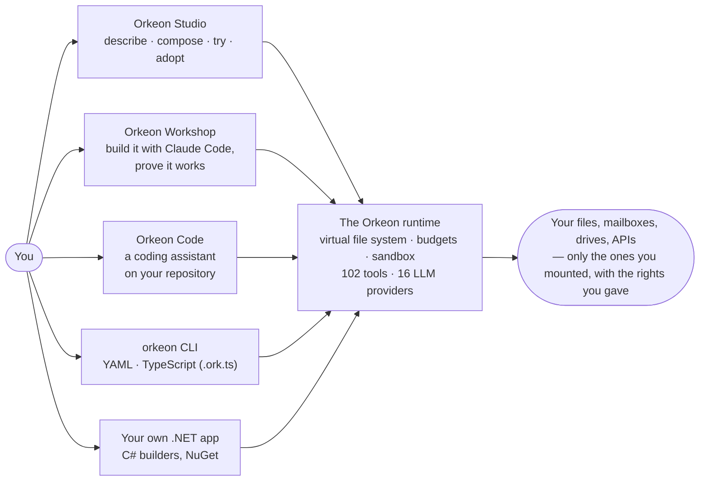

> 🇫🇷 [Version française](README.fr.md)

# Orkeon

[](https://github.com/Orkeon/orkeon/actions/workflows/ci.yml)
[](https://github.com/Orkeon/orkeon/releases)
[](https://www.nuget.org/packages/Orkeon)
[](https://orkeon.github.io/orkeon/)
[](LICENSE.md)

<p align="center">
  
</p>

**Give a team of AI agents real work — your files, your inbox, your drives, your code — and know exactly what it may touch.** Orkeon is a .NET runtime that executes teams of agents under rules declared up front and enforced on every call, and a suite of tools — Orkeon Studio, Orkeon Workshop, Orkeon Code, the `orkeon` CLI — to design, try, run and manage those teams. It runs as happily on a model on your own machine as on a cloud provider; no API key to start.

Version **1.0.0-rc.5**, MIT, .NET 10. Three repositories: this one (the runtime, the CLI, Studio), [orkeon-workshop](https://github.com/Orkeon/orkeon-workshop) and [orkeon-code](https://github.com/Orkeon/orkeon-code).

## What a team does for you

- **Every morning, your inbox is triaged.** A team reads the mail, files the invoices, drafts the three answers that matter — and sends nothing until you say so.
- **A folder of PDFs becomes a report.** Researcher, analyst, writer: three agents, one `/documents` folder they may read, one `/output` folder they may write.
- **Your pull request gets a second pair of eyes.** Orkeon Code reviews it, under a permission mode you chose, inside the one project you mounted.
- **A question lands on your documents, not on the web.** RAG over your files, a local model, nothing leaves the laptop.

Each of these is a team you can describe in a sentence — `orkeon forge "a team that triages my inbox every morning"` — and each runs inside lines you drew.

## How it works



**The boundary sits in front of the model, not behind it.** An agent sees virtual folders (`/workspace`, `/output`), each a mount you declared with the rights you gave; a path outside them is refused before any byte lands on disk. Sending mail and sharing a drive stay closed until an operator opens them. Code runs in a sandbox.

**Autonomy has a budget.** Tool calls, depth, wall time, tokens, spawned agents: the run stops when the budget is spent, and circuit breakers catch the loops. A long run checkpoints and resumes where it stopped.

**It ships like software.** The same runtime runs as the `orkeon-host` service daemon, as a container (`ghcr.io/orkeon/orkeon-runners`), as an apt package or a self-contained binary, or embedded in your own .NET service — OpenTelemetry on the .NET Aspire dashboard, Microsoft Agent Framework interop, MCP client and server, A2A between agents. And for your own C#, [`Orkeon.Compliance.Vfs`](docs/architecture/vfs-compliance.md): a Roslyn analyzer after which raw `System.IO` no longer compiles.

## Try it in two minutes — no API key

One local model, one agent, one writable folder. With [Ollama](https://ollama.com) and the .NET 10 SDK installed:

<!-- quickstart:begin -->
```bash
ollama pull qwen2.5:1.5b
dotnet tool install -g Orkeon.Scripting.Cli --prerelease
orkeon quickstart && cd orkeon-quickstart
orkeon run crew.yaml --mount ./out:/output:rw
```
<!-- quickstart:end -->

`out/hello.md` appears — written by an agent that never saw `out/`: it saw `/output`, the only place this run let it write. Now the same crew, the same command, the mount read-only:

<!-- quickstart-refused:begin -->
```bash
orkeon run crew.yaml --mount ./out:/output:ro
```
<!-- quickstart-refused:end -->

```
file_write [FAIL]: Error: Access denied for '/output/hello.md': required Write, effective ReadOnly. Mounts granting Write: (none).
```

Refused before any byte lands. CI runs both blocks on every change, against a pinned Ollama: the README is the test.

## Pick your door

| | |
|---|---|
| **Orkeon Studio** | The desktop app. **Describe → Compose → Try → Adopt**: say what the team should do, let the assistant propose the agents, their tasks and the folders they may touch — or start from one of the 104 use cases —, try it on a sample, adopt it on demand, hourly or daily. Then run it, follow what it costs, read the history, manage models, folders, mailboxes and drives from one settings screen. Novice or expert mode, five languages, no code. The desktop app is Windows; Linux gets two terminal apps, a settings editor and a run launcher — [Orkeon Studio](docs/architecture/studio.md). |
| **Orkeon Workshop** | Claude Code, harnessed. A container image — Claude Code, the Orkeon CLI, local models on your GPU — and a method: need → tests → team → runs → accepted, every attempt and decision kept on disk, a paid run waiting for your approval. Teams come out ready for Studio; the same harness works on Orkeon itself — [Orkeon/orkeon-workshop](https://github.com/Orkeon/orkeon-workshop). |
| **Orkeon Code** | A coding assistant on the Orkeon runtime. Pair with it in the terminal under the permission mode you choose, or let it run a task to the end; `/review`, `/commit`, `/security-review`, `/analyze`; one mounted project, an allow-listed shell. Alpha — [Orkeon/orkeon-code](https://github.com/Orkeon/orkeon-code). |
| **`orkeon` CLI** | `orkeon run` executes a team written in YAML or TypeScript (`.ork.ts`); `orkeon forge "…"` drafts, sandbox-tests and promotes one from a sentence; `orkeon quickstart` writes the two-minute crew above; `init`, `doctor`, `email login` and `drive login` do the plumbing — [CLI reference](docs/reference/cli.md). |
| **The library** | `dotnet add package Orkeon --prerelease` — the same engine inside your product: C# builders, Clean Architecture, typed end to end — [Bootstrap and execution](docs/getting-started/bootstrap.md). |

The team you compose in Studio is the YAML the CLI runs, and the crew your own .NET code loads. One runtime, same rules, whichever door you take.

## What's in the box

102 built-in tools (mail over IMAP, SMTP and Microsoft Graph; Google Drive and OneDrive; web, HTTP, databases, Office and PDF, secure code execution, semantic code analysis) · 16 LLM providers, local models included (Ollama, Docker Model Runner, embedded llama.cpp) · 6 memory providers · 6 orchestration strategies, from a plain sequence to a graph or an autonomous team under budget · checkpoint and resume · plugins in isolated load contexts · 104 runnable examples. Every number here is recomputed by CI on each change — a README that disagrees fails the build.

## Install

| | |
|---|---|
| **Windows** — CLI + Studio | `orkeon-cli-<version>-win-x64.zip` or the `.msi` from the [releases](https://github.com/Orkeon/orkeon/releases), then `install.cmd`. Self-contained. |
| **Debian / Ubuntu** — CLI + Studio terminal apps | `sudo apt install orkeon` after adding the [signed apt source](docs/guides/install-with-apt.md). |
| **macOS** — CLI | The `osx-arm64` / `osx-x64` tarball from the releases, then `./install.sh`. |
| **Container** | `docker run -it --rm -e ORKEON_RUNNER=shell ghcr.io/orkeon/orkeon-runners` — the examples bundled. |
| **In your .NET app** | `dotnet add package Orkeon --prerelease` (+ `Orkeon.Tools` for the built-in tools). |
| **From source** | `git clone` **without** `--recursive` (the private maintainer submodules are not needed by anything public), then `dotnet build Orkeon.sln` — [From source](docs/getting-started/three-ways-to-run-orkeon.md#1-from-source). |

Then `orkeon init` to pick a provider and a model; `orkeon doctor` when something looks off. Checksums, signed attestations, updates: [Three ways to run Orkeon](docs/getting-started/three-ways-to-run-orkeon.md) · [Verify what you install](docs/guides/verify-what-you-install.md).

## Learn more

[Getting started](docs/getting-started/overview.md) · [Write a team in YAML, TypeScript or C#](docs/getting-started/yaml-and-builders.md) · [Forge a team from a need](docs/getting-started/forge-a-team-from-a-need.md) · [Give your agents a mailbox](docs/getting-started/give-your-agents-a-mailbox.md) · [Local models](docs/guides/local-models.md) · [Orchestration](docs/orchestration/process-types.md) · [Orkeon Studio](docs/architecture/studio.md) · [Examples](examples/README.md) · [Full index](docs/INDEX.md) *(also [in French](docs/fr/INDEX.md))* — published at **<https://orkeon.github.io/orkeon/>**.

## Join in

Show us what your team does: [Discussions](https://github.com/Orkeon/orkeon/discussions) is where questions and show-and-tell live. Bugs and ideas go through the [issue forms](https://github.com/Orkeon/orkeon/issues/new/choose), vulnerabilities through [private reporting](SECURITY.md). Contributions are welcome — [CONTRIBUTING.md](CONTRIBUTING.md) says how, the [Code of Conduct](CODE_OF_CONDUCT.md) says in what spirit.

Coverage is [measured in public](https://github.com/Orkeon/orkeon/actions/workflows/coverage.yml), known constraints are in [limitations](docs/reference/limitations.md), and what happens if the project stops is written down in [SUPPORT.md](SUPPORT.md#if-the-project-stops): MIT, a reproducible build, no private infrastructure, forkable by anyone.

## License

Orkeon is released under the [MIT License](LICENSE.md).
