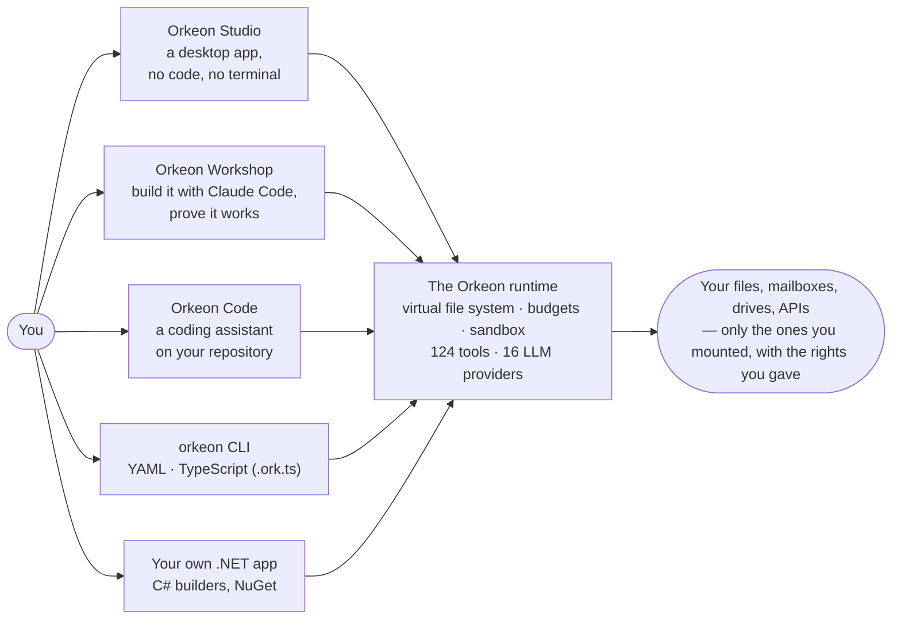

> 🇫🇷 [Version française](README.fr.md)

# Orkeon

[](https://github.com/Orkeon/orkeon/actions/workflows/ci.yml)
[](https://github.com/Orkeon/orkeon/releases)
[](https://www.nuget.org/packages/Orkeon)
[](https://orkeon.github.io/orkeon/)
[](LICENSE.md)

<p align="center">
  
</p>

**AI agent teams that stay inside the lines.** Every file, endpoint and budget an agent may use is declared, then enforced by the runtime.

Orkeon is an open-source framework for building and orchestrating teams of AI agents in .NET: one runtime that executes a team under rules declared up front and enforced on every call, and a suite of tools — Orkeon Studio, Orkeon Workshop, Orkeon Code, the `orkeon` CLI — to design, try, run and manage those teams. It runs as happily on a model on your own machine as on a cloud provider; no API key to start.

MIT, .NET 10. Four repositories: this one (the runtime, the CLI), [orkeon-workshop](https://github.com/Orkeon/orkeon-workshop), [orkeon-code](https://github.com/Orkeon/orkeon-code) and [orkeon-studio](https://github.com/Orkeon/orkeon-studio).

## Why Orkeon

AI agents can now act: read files, call APIs, write code, send messages. That is what makes them useful, and what makes them risky. Two obstacles keep them at the demo stage. **No boundary**: an autonomous agent can read what it should not, write where it must not, loop, or spend without limit. **No continuity**: the tool used to tune an agent is rarely the one used to build the application, so the prototype is rewritten before it becomes a product. The problem is not the intelligence of the models; it is what is missing around them.

Orkeon rests on two convictions:

1. **Trust is built in the runtime, not in the prompt.** An instruction in a prompt is a request: the model may ignore it. A rule in the runtime is a limit: it applies whatever the model decides.
2. **What you tune is what you deploy.** A team of agents should never be rewritten to go from trial to application.

Two words come back throughout: a **team** (a *crew* in the code) is a set of agents, each with a role, working together on a mission; the **runtime** is the engine that executes the team and enforces the rules. There is only one, however you use Orkeon.

## What a team does for you

- **Every morning, your inbox is triaged.** A team reads the mail, files the invoices, drafts the three answers that matter — and sends nothing until you say so.
- **A folder of PDFs becomes a report.** Researcher, analyst, writer: three agents, one `/documents` folder they may read, one `/output` folder they may write.
- **Your pull request gets a second pair of eyes.** Orkeon Code reviews it, under a permission mode you chose, inside the one project you mounted.
- **A question lands on your documents, not on the web.** RAG over your files, a local model, nothing leaves the laptop.

Each of these is a team you can describe in a sentence — `orkeon forge "a team that triages my inbox every morning"` — and each runs inside lines you drew.

## How it works



### A boundary declared, then enforced

**What an agent may touch is declared.** An agent never sees the real disk: it sees virtual folders (`/workspace`, `/output`), each a mount you declared with the rights you gave, read-only or read-write; a path outside them is refused before any byte lands on disk. Orkeon's file tools go through this virtual file system; a tool that starts a process, such as the shell, runs under its own confinement ([known limits](docs/reference/limitations.md)). The same logic covers the other resources: endpoints, mailboxes, code running in a sandbox.

**What is sensitive stays closed until a person opens it.** Sending mail and sharing a drive stay closed until an operator opens the allow-list. When a host turns the permission gate on, an action that needs approval goes to the host's approval channel, to a person, and is refused when the host has none: the model cannot grant it to itself; and a team generated from a sentence is, by default, adopted only after your verdict. Opening access is a human decision, never an agent's deduction.

**Autonomy has a budget.** An autonomous team runs under a budget on tool calls, depth, wall time, tokens and spawned agents: the run stops when the budget is spent, and circuit breakers catch the loops. The other modes are bound by the token and cost cap the host sets; there is none by default. An agent can fail; it cannot spend more than it was given.

**The rule can bind the code itself.** [`Orkeon.Compliance.Vfs`](docs/architecture/vfs-compliance.md) is a standalone Roslyn analyzer: add it to any C# project, with or without Orkeon, and direct file access through `System.IO` no longer compiles.

### From the idea to the application, without a rewrite

**One team, three notations, one runtime.**

| Notation | Use |
|---|---|
| **YAML** | A declarative description, readable and versionable, no code |
| **TypeScript** (`.ork.ts`) | The flexibility of a script, transpiled on the fly, no recompilation |
| **C#** | Full control, at the heart of a .NET application |

The same runtime executes all three. None is a provisional step: choose by the complexity the team has to handle, not by the stage of the project. A team written in YAML or TypeScript belongs in a C# application, and can stay there.

**The team you tuned is the team you integrate.** The runtime that ran the first trial is the one that runs in the final application: no redevelopment, no dead end — when complexity grows you change notation, not foundation — and the boundary follows the team, since mounts, budgets and circuit breakers are carried by the runtime. What changes from one environment to the next is configuration: the model, the mounted folders, the secrets. The team's definition does not. Orkeon Code is the demonstration: the project's own coding assistant is built on the Orkeon runtime, works in a terminal, runs unattended from a script or a CI job, and another application starts its teams through the `orkeon` CLI.

**An agent is software, not a script.** A team deploys, keeps its state and is observed like any service. *Deployment*: the `orkeon` CLI, a container (`ghcr.io/orkeon/orkeon`), native packages for Windows (MSI) and Debian or Ubuntu (apt), a self-contained archive for macOS, the `orkeon-host` service daemon, or a library embedded in your own .NET application. *State*: memory in a durable store and checkpoints, both opt-in, to resume an interrupted run where it stopped; a run's model answers can be recorded and replayed, and two evaluation reports compared. *Observability*: traces, metrics and logs exported through OpenTelemetry — the .NET Aspire dashboard reads them — and a stream of events per run.

### An open project

**Standards, not lock-in.** MCP as client and as server (the server over stdio); A2A, still experimental, for discovery and communication between agents; Microsoft Agent Framework both ways — an Orkeon team runs as a MAF agent, and a MAF agent can be the brain or a tool of an Orkeon agent. Orkeon does not replace these building blocks: it plugs into them. The choice of model stays yours: cloud vendors, aggregators or local models.

**Open and verifiable.** MIT. A security boundary is not taken on trust: this one can be read, tested and challenged, and its [known limits](docs/reference/limitations.md) are documented with the project.

## Try it in two minutes — no API key

One local model, one agent, one writable folder. With [Ollama](https://ollama.com) and the .NET 10 SDK installed:

<!-- quickstart:begin -->
```bash
ollama pull qwen2.5:1.5b
dotnet tool install -g Orkeon.Scripting.Cli
orkeon quickstart && cd orkeon-quickstart
orkeon run crew.yaml --mount ./out:/output:rw
```
<!-- quickstart:end -->

`out/hello.md` appears — written by an agent that never saw `out/`: it saw `/output`, the only place this run let it write. Now the same crew, the same command, the mount read-only:

<!-- quickstart-refused:begin -->
```bash
orkeon run crew.yaml --mount ./out:/output:ro
```
<!-- quickstart-refused:end -->

```
file_write [FAIL]: Error: Access denied for '/output/hello.md': required Write, effective ReadOnly. Mounts granting Write: (none).
```

Refused before any byte lands. CI runs both blocks on every change, against a pinned Ollama: the README is the test.

## Pick your door

| | |
|---|---|
| **Orkeon Studio** | A desktop application for Windows 10 and 11 only: build a team with no code and no terminal, in four steps — *Describe → Compose → Try → Adopt*. It drives the `orkeon` CLI, which you install first — [Orkeon/orkeon-studio](https://github.com/Orkeon/orkeon-studio). |
| **Orkeon Workshop** | Claude Code, harnessed. A container image — the Orkeon CLI, local models on your GPU, Claude Code installed at the first start — and a method: need → tests → team → runs → accepted, every attempt and decision kept on disk, a paid run waiting for your approval. Teams come out ready for the `orkeon` CLI; the same harness works on Orkeon itself — [Orkeon/orkeon-workshop](https://github.com/Orkeon/orkeon-workshop). |
| **Orkeon Code** | A coding assistant on the Orkeon runtime. Pair with it in the terminal under the permission mode you choose, or let it run a task to the end; `/review`, `/commit`, `/security-review`, `/analyze`; one mounted project, an allow-listed shell — [Orkeon/orkeon-code](https://github.com/Orkeon/orkeon-code). |
| **`orkeon` CLI** | `orkeon run` executes a team written in YAML or TypeScript (`.ork.ts`); `orkeon forge "…"` drafts, sandbox-tests and promotes one from a sentence; `orkeon quickstart` writes the two-minute crew above; `init`, `doctor`, `email login` and `drive login` do the plumbing — [CLI reference](docs/reference/cli.md). |
| **The library** | `dotnet add package Orkeon` — the same engine inside your product: C# builders, Clean Architecture, typed end to end — [Bootstrap and execution](docs/getting-started/bootstrap.md). |

The team you forge from a sentence is the YAML the CLI runs, and the crew your own .NET code loads. One runtime, same rules, whichever door you take.

## What Orkeon guarantees, and what it does not

**Orkeon guarantees a perimeter.** An agent reaches only what was declared, with the rights declared, within the budget allotted.

**Orkeon does not guarantee what happens inside that perimeter.** Three limits, said plainly:

- **An agent can be wrong.** The boundary bounds the consequences of a mistake; it does not make the result right. Human review stays necessary wherever the stakes call for it.
- **A right that was granted can be misused.** In a folder opened for writing, an agent can write what it should not. The boundary is only as good as the precision of its declarations.
- **What an agent reads is sent to the model.** With a cloud provider that data leaves the company; with a local model it stays. Orkeon allows both and leaves the choice to those who answer for it.

## What Orkeon is not

- **Not a demo tool.** It is designed for production, not for the throwaway prototype.
- **Not a chain of prompts.** It provides state, memory, tools, deployment and observability.
- **Not a dead end.** What is tuned with Orkeon goes into an application without being rewritten.
- **Not a guardrail bolted on afterwards.** The limits are in the runtime from the start, not in a filter placed at the exit.

## Who it is for

- **.NET teams** who want to put agents into production without leaving their ecosystem.
- **Architects and security officers** who must be able to say precisely what an agent is allowed to do.
- **Business teams** who want to automate a task without writing code, knowing exactly what their agents have access to.

## What's in the box

124 built-in tools (mail over IMAP, SMTP and Microsoft Graph; Google Drive and OneDrive; web, HTTP, databases, Office and PDF, secure code execution, semantic code analysis) · 16 LLM providers (14 vendors, 2 aggregators), local models included (Ollama, Docker Model Runner, embedded llama.cpp) · 6 memory providers · 6 orchestration strategies, from a plain sequence to a graph or an autonomous team under budget · a staged RAG pipeline · checkpoint and resume · plugins in isolated load contexts · 104 runnable examples. Every number here is recomputed by CI on each change — a README that disagrees fails the build.

## Install

| | |
|---|---|
| **Windows** — CLI | `orkeon-cli-<version>-win-x64.zip` or the `.msi` from the [releases](https://github.com/Orkeon/orkeon/releases), then `install.cmd`. Self-contained. |
| **Debian / Ubuntu** — CLI | `sudo apt install orkeon` after adding the [signed apt source](docs/guides/install-with-apt.md). |
| **macOS** — CLI | The `osx-arm64` / `osx-x64` tarball from the releases, then `./install.sh`. |
| **Container** | `docker run -it --rm -e ORKEON_ENTRYPOINT=shell ghcr.io/orkeon/orkeon` — the examples bundled. |
| **In your .NET app** | `dotnet add package Orkeon` (+ `Orkeon.Tools` for the built-in tools). |
| **From source** | `git clone`, then `dotnet build Orkeon.sln` — [From source](docs/getting-started/three-ways-to-run-orkeon.md#1-from-source). To put what you built on your `PATH`: `scripts/install-from-source.ps1` on Windows, `scripts/install-from-source.sh` on Linux and macOS — [Install from source](docs/getting-started/three-ways-to-run-orkeon.md#install-from-source), [with the REPL](docs/getting-started/three-ways-to-run-orkeon.md#install-the-repl-from-source). |

Then `orkeon init` to pick a provider and a model; `orkeon doctor` when something looks off. Checksums, signed attestations, updates: [Three ways to run Orkeon](docs/getting-started/three-ways-to-run-orkeon.md) · [Verify what you install](docs/guides/verify-what-you-install.md).

## Learn more

[Getting started](docs/getting-started/overview.md) · [Write a team in YAML, TypeScript or C#](docs/getting-started/yaml-and-builders.md) · [Forge a team from a need](docs/getting-started/forge-a-team-from-a-need.md) · [Give your agents a mailbox](docs/getting-started/give-your-agents-a-mailbox.md) · [Local models](docs/guides/local-models.md) · [Orchestration](docs/orchestration/process-types.md) · [Examples](https://github.com/Orkeon/orkeon/tree/main/examples) · [Full index](docs/INDEX.md) *(also [in French](docs/fr/INDEX.md))* — published at **<https://orkeon.github.io/orkeon/>**.

## Join in

Show us what your team does: [Discussions](https://github.com/Orkeon/orkeon/discussions) is where questions and show-and-tell live. Bugs and ideas go through the [issue forms](https://github.com/Orkeon/orkeon/issues/new/choose), vulnerabilities through [private reporting](SECURITY.md). Contributions are welcome — [CONTRIBUTING.md](CONTRIBUTING.md) says how, the [Code of Conduct](CODE_OF_CONDUCT.md) says in what spirit.

Coverage is [measured in public](https://github.com/Orkeon/orkeon/actions/workflows/coverage.yml), known constraints are in [limitations](docs/reference/limitations.md), the versioning promise in the [stability policy](docs/reference/stability.md), and what happens if the project stops is written down in [SUPPORT.md](SUPPORT.md#if-the-project-stops): MIT, a reproducible build, no private infrastructure, forkable by anyone.

## License

Orkeon is released under the [MIT License](LICENSE.md).
